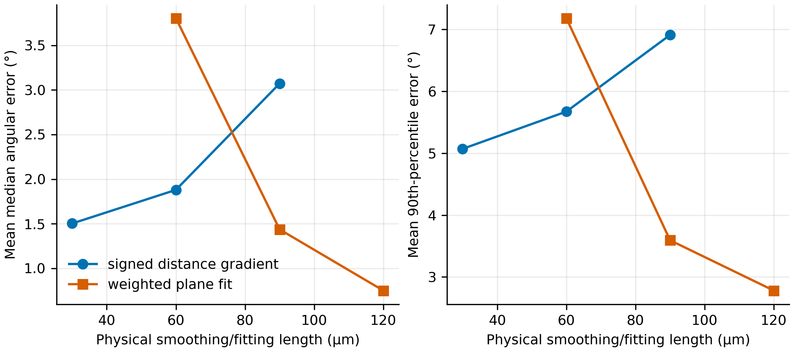
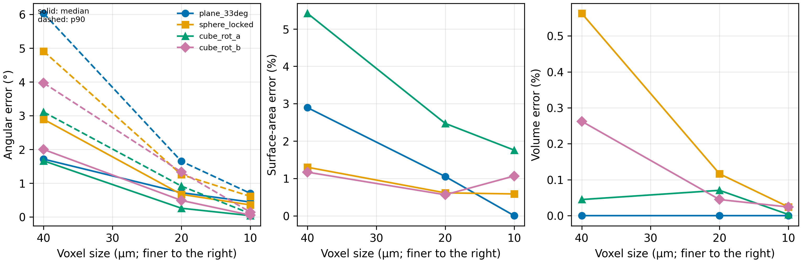
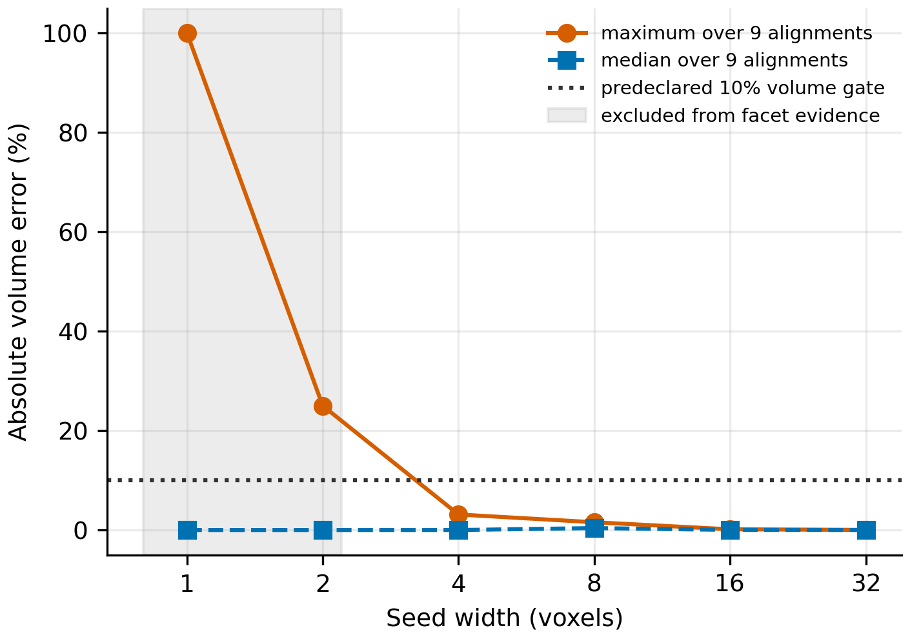

# Phase 2A.3a — surface normals and crystallographic orientation

## Decision

**Conditional GO for a bounded, single-grain CA orientation pilot, provided the
seed is at least 16 voxels across and the numerical geometry remains within the
verified range.** This is not a GO for multi-grain growth, impingement, film
flow, permeability, vapour diffusion, PNM coupling, or calibrated NaCl growth
kinetics. One- and two-voxel seeds are a numerical **NO-GO** for orientation.

The locked verification passed every pre-registered finest-grid gate without
changing the selected estimator, fitting radius, cases, or thresholds. A
post-lock robustness diagnostic was added because a one-voxel cube happened to
match the reference volume in one alignment. Independent translations and
rotations showed that this was aliasing, not evidence of resolved geometry.

## Mathematical definitions and conventions

The signed distance is negative in solid salt and positive in the exterior.
The outward unit normal is therefore

\[
\mathbf n_{\rm lab}=\frac{\nabla\phi}{\lVert\nabla\phi\rVert}.
\]

The Euclidean distance transform is shifted by half a voxel so that its zero
level lies between unlike cell centres. Cartesian derivatives use second-order
central differences away from array boundaries. Interface samples are the
physical centres of solid–exterior voxel faces.

Two independent estimators were implemented:

1. **Signed-distance gradient.** The signed-distance field is Gaussian-smoothed
   with a standard deviation specified in metres, differentiated, interpolated
   to interface samples, and normalized.
2. **Weighted local plane fit.** All interface samples inside a physical search
   radius are fitted by Gaussian-weighted PCA. The eigenvector of the smallest
   covariance eigenvalue is the plane normal; the unsmoothed signed-distance
   gradient resolves its outward sign. Fits with fewer than six neighbours or
   a degenerate covariance are invalid rather than silently filled.

The selected 120 µm plane-fitting radius is a physical scale, not a fixed
number of voxels. It spans 3, 6, and 12 voxels on the locked 40, 20, and 10 µm
grids.

For a grain-to-laboratory rotation matrix \(R_g\), the implemented cubic model
is

\[
\mathbf n_c=R_g^T\mathbf n_{\rm lab},\qquad
q_4=n_{c,x}^4+n_{c,y}^4+n_{c,z}^4,
\]

\[
w=\exp\!\left[\alpha\left(q_4-\frac13\right)\right].
\]

These are dimensionless demonstration weights. Their ratios are not asserted
to be physical facet-growth-velocity ratios.

## Analytical reference geometries

All references are defined continuously before sampling a 1.2 mm cubic domain.
The development set contained an axis-aligned central plane, a 17° central
plane, a centred 0.28 mm-radius sphere, and a 0.50 mm axis-aligned cube. The
locked set was independent: a 33° plane, a shifted 0.27 mm-radius sphere, and
0.50 mm cubes rotated by `(17°, 23°, 11°)` and `(-19°, 31°, 7°)` using
\(R_zR_yR_x\).

Plane volume is one-half of the symmetric domain; plane area is computed from
the exact plane–box intersection polygon. Sphere and cube volume and area use
their analytical formulae. Voxel volume is the occupied-cell count times
\(\Delta x^3\). Surface area is estimated from interface-face projections,
\(\sum \Delta x^2/(|n_x|+|n_y|+|n_z|)\); the raw Cartesian face area is also
retained. The corrected area is coupled to the normal estimator and is not an
independent triangulated-surface validation.

Cube samples are classified using a physical edge-exclusion distance. Face
interiors receive their unique analytical face normal. Mathematical edges and
corners are reported separately and excluded from angular-error statistics;
no unique physical normal is assigned to them.

## Pre-registration and method selection

The development configuration is
`phase2_ca/configs/phase2a3a_method_development.json` (SHA-256
`8cc34c76894914dfc1ae3a73972c48250d182851266a4debf521f843495c34cd`).
The locked protocol was written after development and before any locked case
was run; its SHA-256 is
`9871e1ae7a496032c7b0822c320b88b16ed5730632f14c8a3efeee7ded3e2473`.

The predeclared ranking minimized the unweighted mean p90 error, then median
error, with runtime as a tie-breaker. Results averaged over four development
geometries and two grids were:

| Estimator | Physical length | Mean median error | Mean p90 error | Runtime for 8 cases |
|---|---:|---:|---:|---:|
| Weighted plane fit | 120 µm | 0.751° | 2.780° | 1.291 s |
| Weighted plane fit | 90 µm | 1.436° | 3.594° | 1.059 s |
| SDF gradient | 30 µm | 1.503° | 5.071° | 0.204 s |

Thus the 120 µm weighted plane fit was locked. The SDF method is faster, but it
did not satisfy the selection rule as well on the independent development set.



## Locked normal and geometry results

At the finest 10 µm grid:

| Locked geometry | Median | p90 | Maximum where meaningful | Area error | Volume error | Runtime |
|---|---:|---:|---:|---:|---:|---:|
| Plane, 33° | 0.442° | 0.700° | 1.434° | 0.004% | <0.001% | 1.150 s |
| Shifted sphere | 0.356° | 0.609° | 0.883° | 0.585% | 0.024% | 1.407 s |
| Rotated cube A, face interiors | 0.038° | 0.100° | 0.199° | 1.758% | 0.003% | 1.366 s |
| Rotated cube B, face interiors | 0.054° | 0.143° | 0.331° | 1.065% | 0.024% | 1.134 s |

All finest-grid median, p90, maximum, area, and volume tolerances passed. For
every case, finest-grid p90 error was no worse than the coarsest result plus the
predeclared 0.5° slack, and area error was lower than on the 40 µm grid. The 12
locked geometry evaluations took 6.86 s in total on the recorded host.



## Cubic invariants and rotation covariance

Exact tests returned \(q_4=1\), \(1/2\), and \(1/3\) for `<100>`, `<110>`,
and `<111>`. All 24 proper cubic signed-permutation rotations produced
identical weights to machine precision. For
\(\alpha=+(3/2)\ln 2\), the weights were 2.000, 1.189, and 1.000; for the
negative value they were 0.500, 0.841, and 1.000. \(\alpha=0\) returned one
for every orientation.

Three numerical experiments were separated:

- **A — geometry rotation, isotropic weights:** all weights remained exactly
  one. After inverse rotation and nearest-interface matching, the p90 normal
  covariance error decreased from 3.109° at 40 µm to 0.100° at 10 µm.
- **B — crystal rotation at fixed geometry:** the weight field changed, with a
  finest-grid RMS change of 0.304. This distinguishes crystallographic rotation
  from merely rotating the laboratory geometry.
- **C — joint geometry and crystal rotation:** after returning to the common
  frame, weight RMSE decreased from 0.04125 at 40 µm to 0.000749 at 10 µm;
  p90 absolute error decreased from 0.06749 to 0.001146. The coarse grid exceeds
  the finest-grid weight tolerance, but the pre-registered gate was explicitly
  evaluated at the finest grid and passed with a clear refinement trend.

Matching used nearest interface samples after inverse rigid rotation, with a
2.5-voxel search limit; it did not require arbitrary rotated binary masks to be
identical. The matched fraction was 1.0 at all three resolutions.

## Resolution gate

The original aligned resolution table correctly rejected normal estimation at
one, two, and four voxels because the 120 µm physical support could not be
formed. Its single-alignment volume column nevertheless gave a coincidental
zero error for the one- and two-voxel cubes. That result is retained, not
rewritten.

A post-lock robustness diagnostic then evaluated three rotations and three
sub-voxel translations without altering the locked protocol. Maximum volume
error was 100%, 25%, 3.13%, 1.56%, 0.146%, and 0.021% at 1, 2, 4, 8, 16, and
32 voxels across, respectively.



The bounded numerical requirements are therefore:

| Purpose | Minimum resolution | Evidence and limitation |
|---|---:|---|
| Robust volume representation | 4 voxels across | Maximum error ≤10% over the tested rotations/translations; not a universal bound |
| Surface-normal estimation | 8 voxels across | Valid fraction 1.0 and p90 11.41° |
| Facet orientation | 16 voxels across | 560 face-interior samples and p90 1.63°; 1–2 voxels are excluded by design |
| Narrow gap width | 5 voxels across | One-cell boundary uncertainty is then ≤20%; not a flow-resolution criterion |

The recommendation for a single-grain CA pilot uses the strictest relevant
seed requirement, at least **16 voxels across**. A one- or two-voxel seed cannot
meaningfully encode crystallographic orientation even if its mass or volume
ledger is exact.

## Numerical limitations and claim boundary

- The plane fit reconstructs a local tangent, not a crystallographic facet.
- A fixed 120 µm fit radius smooths real features below that scale and is not a
  calibrated NaCl material length.
- Cube edge/corner normals remain set-valued; a future growth algorithm must
  declare an explicit edge policy rather than reuse face-interior statistics.
- The surface-area estimate depends on the estimated normal and is not an
  independent mesh-area benchmark.
- Rotation covariance uses nearest-interface matching. Its refinement trend is
  evidence of bounded interpolation error, not exact voxel covariance.
- The gap rule is geometric. It does not establish film connectivity,
  permeability, or transport convergence.
- No result here validates \(\alpha\), attachment kinetics, facet velocities,
  multi-grain impingement, or experimental NaCl morphology.

## Reproduction

From the repository root:

```powershell
python phase2_ca/run_phase2a3a_verification.py --stage development --config phase2_ca/configs/phase2a3a_method_development.json --output phase2_ca/outputs/phase2a3a_development_reproduced
python phase2_ca/run_phase2a3a_verification.py --stage locked --config phase2_ca/configs/phase2a3a_locked_protocol.json --output phase2_ca/outputs/phase2a3a_locked_reproduced
python phase2_ca/run_phase2a3a_resolution_audit.py --output phase2_ca/outputs/phase2a3a_resolution_audit_reproduced
$env:PYTHONPATH=(Resolve-Path 'phase2_ca/src').Path + ';' + (Resolve-Path 'phase1_mass_budget/src').Path + ';' + (Resolve-Path 'prat_dynamic_growth/src').Path
python -m pytest -q
```

The committed development, locked, and post-lock output directories contain
CSV source tables, JSON manifests and decisions, PNG/SVG figures, and SHA-256
inventories. Reproduction should use a new output directory because validation
scripts intentionally refuse implicit overwrite.
