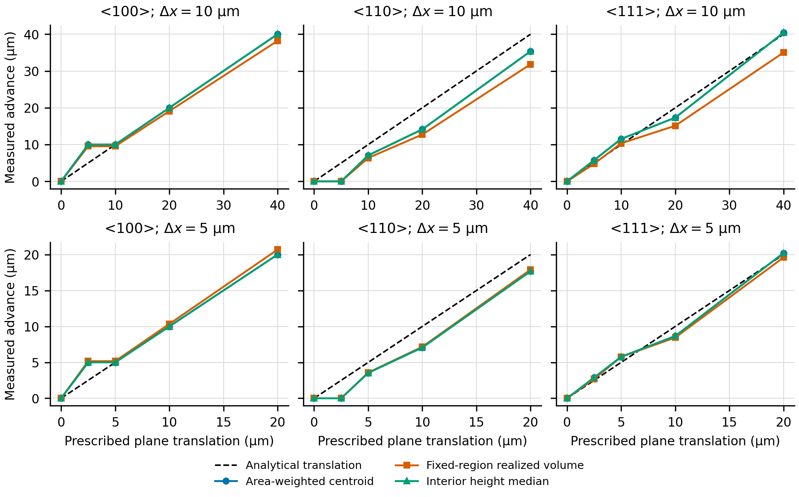
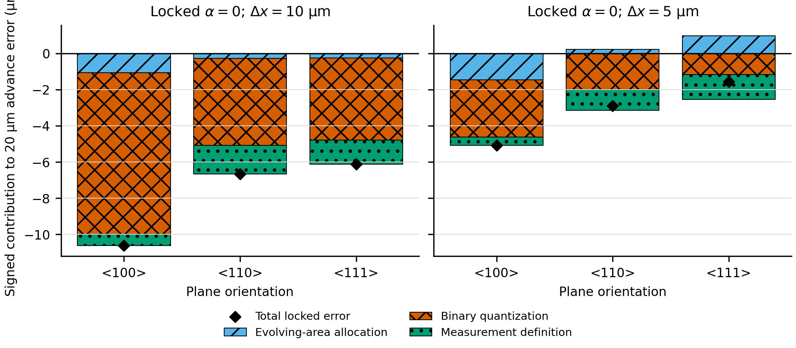
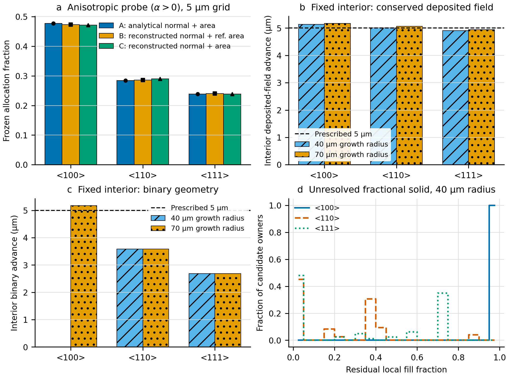
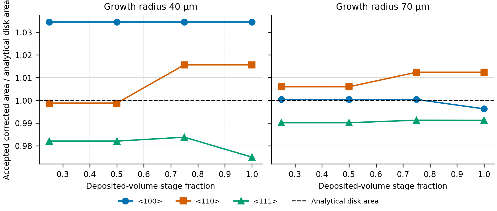

# Phase 2A.3b-4R — Root-cause audit of dynamic front errors

## Decision

**The Phase 2A.3b-4 locked `NO_GO_DYNAMIC_PLANAR_FRONT` decision remains unchanged.**

The conservative salt-volume ledger is numerically sound, but the binary-voxel geometry is not an adequate front representation for quantitative normal advance. At the locked 5 µm grid and 20 µm target advance, binary quantization contributes **−3.169, −2.006, and −1.173 µm** for `<100>`, `<110>`, and `<111>`, respectively. The current area-weighted centroid adds **−0.470, −1.127, and −1.361 µm**. Evolving reconstructed-area allocation contributes **−1.447, +0.232, and +0.975 µm**; the positive values partly compensate other errors rather than validating the method.

At `alpha = 0`, reconstructed normals cannot affect the flux weights by definition. A frozen `alpha > 0` diagnostic gives at most a 0.40 percentage-point A-to-B allocation-share change from reconstructed normals and a 0.36 percentage-point B-to-C change from corrected areas in the 5 µm, 70 µm-radius final geometry. These effects are measurable but are not large enough to explain the locked isotropic failure.

The minimum justified next architecture is a **conservative cell volume-fraction front** whose interface position, normals, and areas are reconstructed subvoxel-wise (PLIC or a height-function method). The present binary mask may remain as a derived connectivity indicator, but it should no longer define the quantitative interface. A standalone level set is not sufficient because it would give up the mass closure already achieved; if a level set is later used, it should be coupled to and corrected by the conservative volume fraction.

No multigrain, hydraulic, permeability, vapour, PNM, or level-set implementation was started.

## Evidence boundary

This is a focused numerical root-cause audit, not a replacement validation campaign.

- Base commit: `2e6eb17800311c5a966c5ee5127f2152bbf6fe56`.
- Immutable source results: `phase2_ca/outputs/phase2a3b4_locked/evolving_planar_fronts.csv`, SHA-256 `fa6992b1ba4e72d557f3f726dd5089a3f889cec07358a986606d8cd0ad5a4583`.
- New calculations: `alpha = 0`, the three ideal plane families, 10 and 5 µm grids, a 5 µm deposited-volume target, and paired 40/70 µm growth radii with a fixed 20 µm interior observation radius.
- The new 40 µm-radius case uses the same 240 µm domain as its paired 70 µm case to isolate growth-radius effects. It is a matched diagnostic reproduction, not a relabelling of the locked 200 µm-domain test.
- The 70 µm case has 3.0625 times the growth area of the 40 µm case, while both receive the same 5 µm deposited volume per analytical growth area.
- All new diagnostics are deterministic; no statistical confidence interval is implied.

The raw tables, transformations, figures, and hashes are in `phase2_ca/outputs/phase2a3b4r_front_error_audit/`.

## 1. Source-code audit

### Current measurement

`DynamicInterfaceFluxSystem._front_geometry()`:

1. calls `_active_surface()`;
2. retains only valid reconstructed faces whose normal alignment exceeds `minimum_normal_alignment` and whose face centroid lies inside the radial growth window;
3. reports

\[
z_A = \frac{\sum_f A_f (\mathbf{x}_f\cdot\mathbf{n}_{ref})}{\sum_f A_f}.
\]

Therefore, the reported position is a statistic of the **current accepted face set**, not a volume-conservative state variable. Face creation, face removal, changing corrected areas, or filtering changes can move `z_A` even when their net deposited-volume implication differs. Conversely, conserved local deposition can accumulate without moving `z_A` until a binary voxel is realized.

### Allocation and realization

`_candidate_fluxes()` integrates `A_f kappa_f` over accepted faces. `advance()` deposits a continuous local volume into persistent candidate reservoirs, but changes the geometry only when one reservoir reaches a full voxel volume. The code therefore contains two distinct states:

- **deposited fractional solid:** conserved volume already assigned to a candidate owner;
- **binary geometry:** realized full voxels only.

`cumulative_deferred_volume_m3` has a different meaning: incoming salt that could not be assigned to any active interface. It was zero in every new case and must not be combined with fractional deposited solid.

### Predeclared additive ledger

For `alpha = 0`, the final error was decomposed without fitting:

1. **A:** analytical target advance;
2. **B:** reconstructed normals with analytical/reference area — identical to A at `alpha = 0`;
3. **C:** history-integrated conserved fractional volume divided by the analytical growth area;
4. **D:** realized binary volume divided by the same area;
5. **M:** current area-weighted front position.

The signed components are `B−A` (normal), `C−B` (evolving-area allocation), `D−C` (binary quantization), and `M−D` (measurement definition). They close algebraically to `M−A`; the recorded closure is zero to CSV precision.

## 2. Analytical translated-plane benchmark

Thirty translated-plane states were constructed before any new growth calculation: 3 orientations × 2 grids × 5 prescribed translations.

Key findings:

- The current area-weighted centroid and the interior area-weighted height mean agree to at most `1.5e-14 µm`. For these planar digital surfaces, mean and median are also effectively identical. Replacing the current scalar by another face-centroid mean would therefore not remove the error.
- With an unchanged binary mask, none of the face-based measures reports motion. Apparent motion requires a changed face set or changed face weights.
- The translated binary planes move in orientation-dependent steps. Maximum absolute centroid/height bias was 5.858 µm at 10 µm grid spacing and 2.929 µm at 5 µm. The approximately linear reduction with grid spacing identifies voxel staircasing, not a converged continuum measurement.
- The fixed-cylinder volume estimate has its own cell-centre quadrature error: maximum bias was 8.169 µm at 10 µm and 2.838 µm at 5 µm. It is an independent volume check, not an exact geometrical oracle on a coarse grid.
- For analytical translated planes the reconstructed height spread is zero to roundoff at each realized digital level. The nonzero bias is a discrete level-location bias, not a roughness distribution hidden by its mean.

All mean, median, standard deviation, interquartile range, 5th/95th percentiles, realized volume, and measurement biases are recorded in `translated_plane_benchmarks.csv`.

## 3. Attribution of the locked failure

The following values reuse the immutable locked `alpha = 0` results. Components are signed; positive reconstructed-area terms offset part of the negative error and are not evidence of accuracy.

| Grid | Orientation | Area allocation | Binary quantization | Measurement definition | Total locked error |
|---:|:---:|---:|---:|---:|---:|
| 10 µm | `<100>` | −1.067 µm (−5.33%) | −8.933 µm (−44.67%) | −0.627 µm (−3.14%) | −10.627 µm (−53.14%) |
| 10 µm | `<110>` | −0.265 µm (−1.32%) | −4.807 µm (−24.04%) | −1.597 µm (−7.99%) | −6.669 µm (−33.35%) |
| 10 µm | `<111>` | −0.242 µm (−1.21%) | −4.554 µm (−22.77%) | −1.327 µm (−6.63%) | −6.123 µm (−30.62%) |
| 5 µm | `<100>` | −1.447 µm (−7.23%) | −3.169 µm (−15.84%) | −0.470 µm (−2.35%) | −5.085 µm (−25.43%) |
| 5 µm | `<110>` | +0.232 µm (+1.16%) | −2.006 µm (−10.03%) | −1.127 µm (−5.63%) | −2.901 µm (−14.51%) |
| 5 µm | `<111>` | +0.975 µm (+4.88%) | −1.173 µm (−5.87%) | −1.361 µm (−6.80%) | −1.559 µm (−7.79%) |

This answers the main attribution question for the failed 20 µm test:

- **Measurement definition:** 2.35–6.80 percentage points of the prescribed advance at 5 µm resolution.
- **Evolving area allocation:** −7.23 to +4.88 percentage points. It is orientation dependent but not uniformly error-generating; for `<110>` and `<111>` it compensates other negative errors.
- **Binary voxel quantization:** 5.87–15.84 percentage points, the largest uniformly negative component at 5 µm and much larger at 10 µm.
- **Normal reconstruction:** exactly zero in the isotropic allocation because `kappa = 1` for every normal at `alpha = 0`.

The largest 5 µm total error remains 25.43%; the old failure is not reinterpreted as a pass.

## 4. Controlled normal and area variants

At the final 5 µm, 70 µm-radius geometry, a frozen `alpha = 1.0397207708399179` probe gave:

| Orientation | A: analytical normal + area | B: reconstructed normal + reference area | C: reconstructed normal + corrected area |
|:---:|---:|---:|---:|
| `<100>` | 0.477417 | 0.473374 | 0.471764 |
| `<110>` | 0.283874 | 0.285939 | 0.289580 |
| `<111>` | 0.238709 | 0.240687 | 0.238657 |

The maximum A-to-B change is 0.00404 of total allocation and the maximum B-to-C change is 0.00364. This diagnostic shows that reconstructed normals and corrected areas can perturb anisotropic allocation, but it does not support assigning the isotropic locked error to normals.

## 5. Finite-window effect

The paired diagnostic used a fixed 20 µm interior observation cylinder while increasing the growth radius from 40 to 70 µm.

At the 5 µm grid, the interior conserved deposited-field advances were:

| Orientation | 40 µm growth radius | 70 µm growth radius | Difference |
|:---:|---:|---:|---:|
| `<100>` | 5.139 µm | 5.175 µm | +0.036 µm |
| `<110>` | 5.010 µm | 5.066 µm | +0.057 µm |
| `<111>` | 4.910 µm | 4.945 µm | +0.036 µm |

The orientation spread divided by the mean was 4.56% at 40 µm radius and 4.53% at 70 µm. Enlarging the growth region therefore changed the smooth deposited-field result by at most 1.13% of the 5 µm target and did not materially reduce its orientation spread.

The binary result is discontinuous. For `<110>` and `<111>`, the interior realized advances were unchanged by window enlargement (3.581 and 2.686 µm). For `<100>`, the 40 µm case retained a nearly full unresolved layer and realized 0 µm, whereas the 70 µm case crossed the collective threshold and realized 5.173 µm. This is not evidence that the larger window produces a better continuum front; it is direct evidence that a small boundary/area perturbation can trigger an entire binary layer.

Thus the finite-window boundary is **not the leading smooth error mechanism**, but it can decide on which side of a discontinuous voxel-realization event a planar front falls. A scalar boundary correction cannot remove that instability.

## 6. Active-interface filtering and digital staircasing

Every stage records an exclusive corrected-area partition: invalid reconstruction, outside the physical radial window, reconstructed-normal misalignment, and accepted active area. It also records raw digital staircasing area and growth-created area.

- Invalid-reconstruction area was zero in all targeted cases.
- `minimum_normal_alignment = 0.65` excluded zero corrected area in all targeted cases. Relaxing it would therefore not change these results.
- The radial restriction excludes 73–94% of the full-domain plane area, as expected because only a disk is the prescribed growth region. This large fraction is a geometric scope definition, not itself an error.
- At the final 5 µm, 70 µm-radius state, reconstructed-normal 5th-percentile alignment was 0.9924, 0.9964, and 0.9976 for `<100>`, `<110>`, and `<111>`.
- Raw digital-face alignment would put 100% of `<111>` staircase faces below the 0.65 threshold, but the local plane reconstruction correctly restores their orientation. For `<100>` and `<110>`, the corresponding raw fractions were 4.64% and 0.84% after growth.
- Growth-created faces comprise 97.4–100% of the accepted final active area in the 70 µm cases, yet remain well aligned. Growth-created geometry changes the accepted area but does not fail through the alignment filter.

The accepted corrected area stayed close to the analytical disk area: final deviations were +3.45%, +1.55%, and −2.49% for the 40 µm cases, and −0.40%, +1.23%, and −0.88% for the 70 µm cases.

## 7. Fractional-volume representation

The reservoir table includes every current or historical owner, including active owners with zero residual, with its coordinate, axial position, transverse radius, active/inactive state, binary state, residual fill fraction, and cumulative deposited volume.

The 5 µm, 40 µm-radius `<100>` front is the decisive example:

- 208 candidate owners each retain a mean residual fill fraction of 0.9934;
- no binary voxel is realized in the 5 µm diagnostic;
- the fixed interior deposited-field advance is 5.139 µm while the binary advance is 0 µm.

For `<110>` and `<111>`, residual fractions are spatially heterogeneous rather than synchronized: mean residual fractions are 0.214 and 0.324, with maxima 0.896 and 0.722. Their binary advances are 3.581 and 2.686 µm despite conserved deposited-field advances of 5.010 and 4.910 µm.

The reconstructed height distributions at the final 5 µm, 70 µm-radius stage have mean/median advances of 5.000/5.000, 3.536/3.536, and 2.887/2.887 µm with spreads at roundoff. The binary front is therefore not a rough continuum front whose mean is merely measured poorly; it advances as orientation-dependent flat digital levels while substantial deposited solid remains unresolved below the voxel threshold.

This establishes systematic binary lag relative to the conserved deposition field. It does not establish that any particular PLIC or level-set implementation will be accurate; that requires a separately locked method-development phase.

## 8. Mass balance and numerical integrity

- Maximum absolute new-case volume-ledger residual: `5.048709793414476e-29 m3`.
- Maximum deferred unallocated volume: `0 m3`.
- New error-component closure: zero to CSV precision.
- The previous timestep-partition, rollback, local-cache, and ownership results were not rerun or altered; their locked pass/fail status is preserved.
- All 84 current Phase 2 CA tests pass, including the new measurement/inventory/filter partition tests.

Mass conservation is therefore not the cause of the front-position failure. It is the invariant that the next interface representation must preserve.

## 9. Runtime and resources

The resource policy used two process workers maximum, one native thread per worker, and no GPU. The host exposed 22 logical CPUs; physical cores and available memory were not established, so no higher concurrency was used.

| Case | Wall runtime | Dynamic-update runtime | Event batches | Peak Python-tracked memory |
|:---|---:|---:|---:|---:|
| translated-plane benchmark | 6.34 s | n/a | n/a | not recorded |
| 10 µm, 40 µm radius | 2.82 s | 0.15 s | 0 | 5.88 MB |
| 10 µm, 70 µm radius | 2.89 s | 0.18 s | 0 | 6.01 MB |
| 5 µm, 40 µm radius | 19.99 s | 5.36 s | 5 | 24.28 MB |
| 5 µm, 70 µm radius | 22.74 s | 7.58 s | 4 | 25.54 MB |

Python-tracked memory is not process RSS and must not be interpreted as total memory use.

## 10. Scientific answers

1. **How much comes from the measurement definition?** At the locked 5 µm grid: −0.470 to −1.361 µm, or −2.35% to −6.80% of the prescribed 20 µm advance. It is important but not the leading uniform term.
2. **How much comes from evolving reconstructed area and normal errors?** The isotropic normal term is exactly zero. Evolving-area allocation is −1.447 to +0.975 µm (−7.23% to +4.88%); signs differ by orientation. In a frozen anisotropic probe, reconstructed normals shift total allocation shares by at most 0.40 percentage point and corrected areas by at most another 0.36 percentage point.
3. **How much comes from finite-window effects?** In the fixed 20 µm interior deposited field, enlarging the growth radius changes the 5 µm advance by only 0.036–0.057 µm and leaves orientation spread essentially unchanged. It is not the leading smooth error, although it can trigger a discontinuous whole-layer binary event.
4. **How much comes from binary quantization and unresolved fractional solid?** At the locked 5 µm grid: −1.173 to −3.169 µm (−5.87% to −15.84%), the largest uniformly negative component. The 5 µm diagnostic directly exhibits an almost full unresolved `<100>` layer.
5. **Is a conservative correction within the current binary CA sufficient?** **No for quantitative geometry or later coupling.** A fixed-window volume-derived reporting metric would improve measurement and an analytical-area normalization could reduce allocation bias, but neither removes orientation-dependent layer jumps or supplies a subvoxel interface for normals and areas.
6. **Minimum justified representation?** Retain the exact conservative owner-volume ledger as a cell volume fraction `phi in [0,1]`; reconstruct a subvoxel interface from `phi` using PLIC or a verified height function; compute interface position, normals, and areas from that reconstruction; derive a binary mask only for topology/connectivity. If a level set is added later, use a conservative VOF/level-set coupling rather than an unconstrained level set.

## Deliverables and provenance

- Configuration: `phase2_ca/configs/phase2a3b4r_front_error_audit.json`.
- Diagnostic source: `phase2_ca/src/salt_phase2/front_error_attribution.py`.
- Runner: `phase2_ca/run_phase2a3b4r_audit.py`.
- Figure source: `phase2_ca/plot_phase2a3b4r.py`.
- Unit tests: `phase2_ca/tests/test_front_error_attribution.py`.
- Output manifest, figure manifest, raw CSV tables, PNG/SVG figures, and `SHA256SUMS.txt`: `phase2_ca/outputs/phase2a3b4r_front_error_audit/`.

The figures are general publication-style audit figures because no target journal or submission phase was specified. PNG metadata is opaque RGB at 300.99 dpi; SVG text remains editable. Color is redundantly encoded with markers, line styles, hatching, or panel separation. These checks do not constitute journal or accessibility certification.
