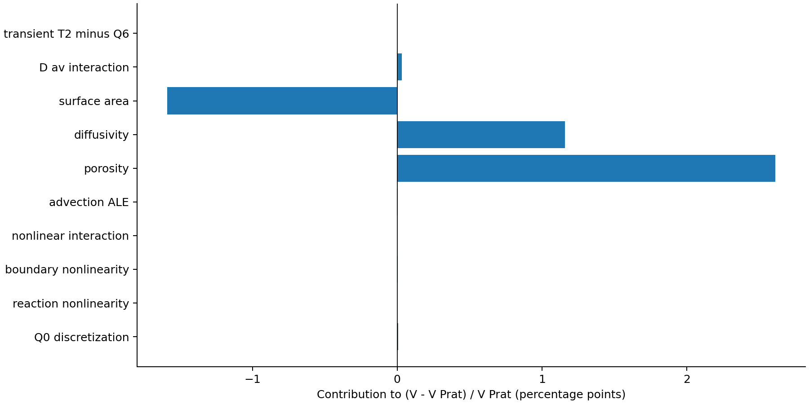
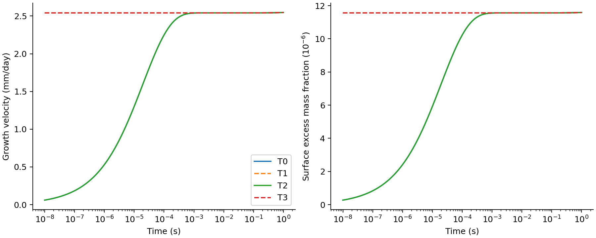
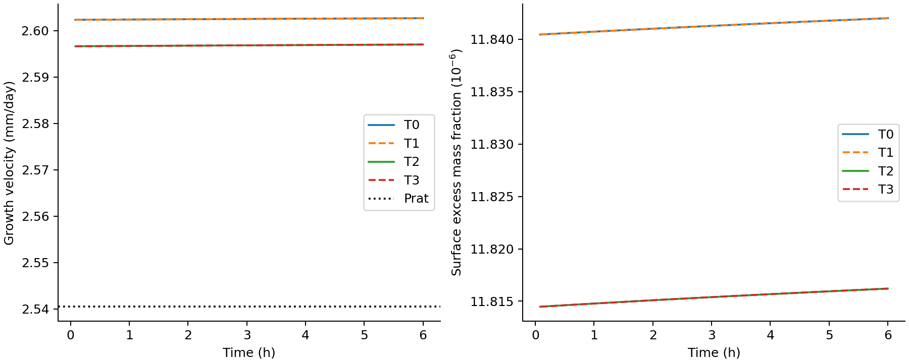
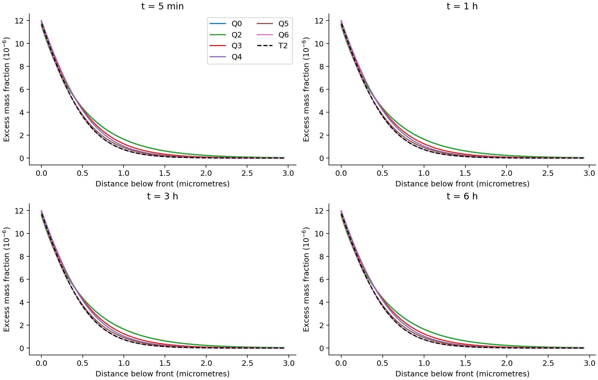
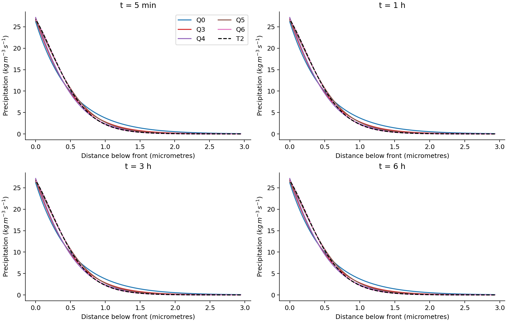
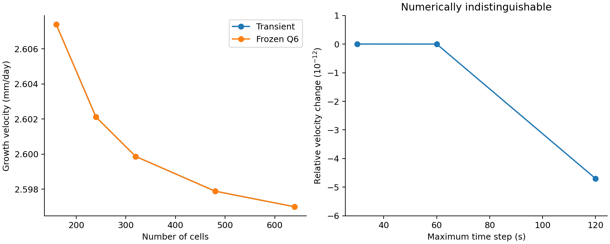

# Results

## M3 current finding: the original 3.33% is revised to 2.23%

The attribution study in `instruction/3.md` is complete. With unchanged
physical parameters, a corrected common ALE liquid/salt mesh flux and 640
cells give a 6 h speed of **`3.00578141e-8 m/s` = `2.59699514 mm/day`**,
versus Prat's `2.94033793e-8 m/s`: **+2.22571%**, replacing +3.32521%.
The finest two grids differ by 0.0342% in velocity. This resolves a small
deviation within the specified continuum closure; it is not physical
validation or invalidation of Prat's law.

The main positive contribution is the nonuniform porosity field. Diffusivity
and specific-area updates have appreciable opposing effects that partly
cancel. The M2 explanation that these updates are individually weak was too
strong. Neither initialization nor reaction linearization explains the
persistent percent-level difference.

See [M3_METHODS.md](M3_METHODS.md) for the equations, including the retained
pore-volume rate in frozen snapshots. Source tables and arrays are in
[outputs/m3/](outputs/m3/). All eleven distinct 6 h runs completed without
stop events; T2 aliases `grid_640` and is not an independent twelfth run.

## Contributions to the velocity difference

Entries are **percentage points of `(V-V_A)/V_A`**, using the same analytical
denominator. Q0R and Q0B separate the nonlinear reduced sink `(1-C)R` from
the nonlinear top condition; the underlying kinetic `R(C)` is linear.
The sum equals T2-A at each time. Extra digits in `contributions.csv` support
reproducibility, not physical precision.

| Mechanism / comparison | 5 min | 1 h | 3 h | 6 h |
|---|---:|---:|---:|---:|
| Q0 discretization, Q0-A | +0.005495 | +0.005849 | +0.006587 | +0.007623 |
| Nonlinear sink, Q0R-Q0 | +0.000141 | +0.000141 | +0.000141 | +0.000141 |
| Nonlinear top condition, Q0B-Q0 | +0.005526 | +0.005526 | +0.005526 | +0.005526 |
| Sink/boundary interaction | ~0 | ~0 | ~0 | ~0 |
| Advection/ALE, Q2-Q1 | -0.002842 | -0.002843 | -0.002846 | -0.002850 |
| Nonuniform porosity, Q3-Q2 | +2.598388 | +2.600734 | +2.605413 | +2.611571 |
| Diffusivity, Q4-Q3 | +1.154487 | +1.155506 | +1.157538 | +1.160216 |
| Specific area, Q5-Q3 | -1.581475 | -1.582621 | -1.584896 | -1.587868 |
| Diffusivity/area interaction | +0.031023 | +0.031082 | +0.031199 | +0.031354 |
| Matched transient, T2-Q6 | ~0 | ~0 | ~0 | ~0 |
| **Total** | **+2.210744** | **+2.213374** | **+2.218663** | **+2.225713** |

At 6 h, Q6-Q3 is -0.39630 points. The dynamic B2/B1 contrast is instead
-0.21791% of B1: Q3 and Q6 share the B2 porosity field, whereas dynamic B1
and B2 have different structural histories. These comparisons answer different
questions. The decomposition is ordered and conditional, not a unique
path-independent causal allocation.

Between 480 and 640 cells, maximum changes across the four times are 0.02934
points (porosity), 0.01280 (diffusivity), 0.01384 (area), and 0.000755
(diffusivity/area interaction). Their signs and cancellation are stable.
These are refinement differences, not confidence intervals or certified
continuum error bounds. Matched linearization/advection contrasts are stable
on these grids, but remain conditional operator effects. The raw transient
and sink/boundary-interaction terms are of order `1e-8` percentage points:
they are negligible/unresolved, not physically measured tiny corrections.

## Numerical share of the original difference

| Calculation | Difference from Prat at 6 h |
|---|---:|
| Archived M1: 160 cells, power 2.5 | +3.32521% |
| Same grid/tolerances, corrected ALE and stable root | +2.99300% |
| Corrected 640 cells, power 3, tighter tolerances | +2.22571% |

The code correction removes **0.33221 percentage points**. The original salt
mesh flux used average porosity while the pore-volume equation used upwind
porosity, so salt advection did not use its own locally consistent liquid
flux. Stable quadratic-root evaluation is included in this code comparison.
Refinement and tighter tolerances remove another **0.76729 points**. About
1.10 points of the old 3.33% are numerical in this comparison, with no physical
parameter change. Remaining discretization error is not zero: Q0-A alone is
still +0.00762 points, and the other operators also retain spatial error.

## Profiles and initialization controls

At 6 h, B2 has `C_top-C_eq = 1.18162059e-5`, `h = 1.64919695 mm`,
`epsilon_min = 0.23612005`, and interpolated `L95 = 1.00907 micrometres`.
Internal precipitation accounts for 25.3785% of cumulative new solid.
Velocity and surface supersaturation remain proportional through the unchanged
interfacial kinetic law.

| Frozen control at 6 h | Velocity (mm/day) | Surface excess mass fraction, times 1e6 |
|---|---:|---:|
| Q0 | 2.54064564 | 11.55981832 |
| Q1 | 2.54078962 | 11.56047342 |
| Q2 | 2.54071721 | 11.56014397 |
| Q3 | 2.60706291 | 11.86201381 |
| Q4 | 2.63653764 | 11.99612242 |
| Q5 | 2.56672389 | 11.67847313 |
| Q6 | 2.59699514 | 11.81620590 |

All four times, integrated reaction and nonlinear solve residuals are retained
in `frozen.csv`; the table displays numerical outputs rather than experimental
precision.

T0/T1 compare equilibrium and matched quasi-steady initialization for B1;
T2/T3 repeat this for B2. Additional runs sample `1e-8` to 1 s. For both pairs,
the sampled relative speed difference stays below 1% after `0.000464 s`,
0.1% after `0.001 s`, and 0.01% after `0.001585 s`. These are sampled
thresholds, not fitted relaxation times. At 1 s, relative differences are
`2.13e-7` and `1.66e-7`. At 5 min through 6 h, speed differences are below
`2e-11` relative; the 6 h height offset is about `1.3e-12 m`. Such tiny values
mean numerically indistinguishable trajectories. Each initialization uses its
actual initial dissolved-salt inventory.

Concentration and precipitation profiles use distance below the moving front
at 5 min, 1 h, 3 h and 6 h. T2 and Q6 overlap at plotting resolution.
`profiles.csv` includes all Q0--Q6 and extra controls; plots omit some nearly
indistinguishable lines.

## Spatial and temporal verification

| Cells, power 3 | V (m/s) | h (mm) | Minimum porosity | L95 (micrometres) | Cells across delta |
|---:|---:|---:|---:|---:|---:|
| 160 | 3.01780736e-8 | 1.65153149 | 0.23878705 | 1.01271 | 11 |
| 240 | 3.01170304e-8 | 1.65035185 | 0.23743351 | 1.00717 | 17 |
| 320 | 3.00910141e-8 | 1.64984642 | 0.23685667 | 1.00462 | 22 |
| 480 | 3.00680955e-8 | 1.64939880 | 0.23634826 | 1.00796 | 33 |
| 640 | 3.00578141e-8 | 1.64919695 | 0.23612005 | 1.00907 | 44 |

The 480-to-640 changes are 0.0342% (speed), 0.0122% (height), 0.0966%
(minimum porosity), 0.1101% (L95), and 0.0915% (internal-solid fraction).
All meet the proposed 0.5% successive-grid gate. L95 is not monotone over
all grids; no Richardson order is asserted. Maximum steps 120/60/30 s change
terminal speed by less than `5e-12` relative under adaptive BDF with tight
tolerances; this is not a measured temporal convergence order.

Independent face reconstruction checks every saved production output.
Maximum normalized semidiscrete residuals are `3.91e-16` (liquid),
`2.15e-16` (salt), `1.54e-16` (solid), and `7.72e-12` (top salt).
Moving-interface liquid and front-volume checks also pass. Terminal global
salt residuals are below `6.1e-11` and bulk residuals below `2.4e-12` across
production cases. These pass the stated algebraic/global gates. Machine-level
algebraic closure does not establish a machine-accurate integrated trajectory.

A separate audit integrates 0.5 s windows from the four B2 snapshots at
tighter tolerance and differentiates the dense trajectory, without taking
derivatives from the model RHS. Four-point central stencils use 0.001, 0.01,
and 0.05 s spacing. Liquid/solid residuals are below `3.4e-11`, but salt
reaches **`1.86e-8`**, slightly above the proposed `1e-8` gate. Inferring
interface concentration from the differentiated height amplifies cancellation
on extremely thin top cells: the interface residual reaches `5.75e-5` for
the smallest stencil and about `1.01e-6` at 0.05 s spacing. The strict
interface gate is therefore **not passed by this trajectory-differentiation
diagnostic**, although the stable-root algebraic check passes. Spacing
dependence exposes conditioning; it does not prove all error is roundoff.
See `trajectory_residuals.csv`.

Thus percent-level attribution is resolved by refinement, but uniformly
validated `1e-8` time-local balances and physically resolved tiny transient
terms are **not** claimed. A conservative-variable or excess-concentration
time integrator would be appropriate if that stricter trajectory tolerance
is required. No sparse/custom integrator, morphology law, or hydraulic
feedback was introduced.

The final T0 run records one SciPy BDF warning, `invalid value encountered
in subtract`; the other final production/startup/window warning lists are
empty. T0 reached 6 h, produced finite outputs, and passes the reported
conservation/initialization comparisons. The warning is retained in its run
metadata and `manifest.json`, not silently suppressed or removed by selecting
a warning-free rerun. Its precise cause was not instrumented, so an entirely
warning-free solver qualification is not claimed. Cache reuse verifies
configuration, source and NPZ hashes. **13 automated tests pass**, covering damaged local
derivatives, Q0 convergence, uniform-control collapse, initialization
inventories, invalid roots, cache invalidation, and stored-study gates.

## Scientific assessment

Nonuniform porosity and opposing coefficient updates are supported as
mechanisms **of this numerical closure**. Initialization and reaction
nonlinearity do not explain a percent-level difference. About one third of
the original excess over Prat was removed by correction and refinement.

Physical validation remains absent: the reaction layer is smaller than the
estimated 3.5-micrometre crystal scale, birth porosity is fixed, supply is
unlimited, and material properties retain their original assumptions. The
result supports a modest modified coefficient, not a demonstrated new growth
regime. Archived low-kinetic-rate cases have not been requalified after the
ALE correction and are not validated blocking evidence.

## Historical M1 results below (superseded where M3 overlaps)

The remaining text preserves the original campaign interpretation. Its
baseline, constitutive contrast and numerical-acceptance statements are not
current conclusions. Archived artifacts remain in `outputs/`; current results
are in `outputs/m3/`.

### Original executive finding

The analytical law is numerically reproduced under its own assumptions. In the
fully conservative evolving-porosity baseline, the post-startup interface
velocity is about 3.1-3.3% higher than Prat's analytical prediction, but
updating `a_v` and `D_eff` (B2 versus B1) changes terminal velocity by only
-0.08% and terminal height by -0.04%. The present closure therefore produces a
small modified growth coefficient, not a demonstrated mechanism change.

This conclusion is numerical, not physically validated: the predicted active
reaction layer is smaller than the estimated crystal size.

## Verification and numerical acceptance

- Reference groups at `h0 = 1 mm`: `Pe = 0.31575`,
  `Da = 3.7905e6`, `Da_top = 5264.59`, `Da* = 7.31193`, and
  `delta_C = 0.5136 micrometres`.
- The 1280-cell Stage A finite-volume solution reproduces the general
  `tanh(sqrt(Da))` velocity with relative error `6.83e-6`.
- At baseline `Da`, the general and large-`Da` analytical velocities agree to
  displayed precision: `2.94034e-8 m/s` (`2.54045 mm/day`).
- On the dynamic grid, `power=2.5` versus the more strongly clustered
  `power=3.0` changes terminal height by 0.15% and terminal velocity by 0.44%.
  The accepted mesh has seven cells across final `delta_C`.
- `max_step = 120, 60, 30 s` produces negligible differences relative to the
  1% observable gate.
- Accepted B2 normalized residuals at 6 h are `-1.21e-11` for total salt and
  `-1.49e-12` for solution-plus-solid mass.

## Baseline comparison at 6 h

| Quantity | Model A | B1 | B2 |
|---|---:|---:|---:|
| Height (mm) | 1.63511 | 1.65603 | 1.65541 |
| Velocity (mm/day) | 2.54045 | 2.62693 | 2.62493 |
| Minimum porosity | constant 0.43 | 0.24389 | 0.24313 |
| `L95` (micrometres) | not an inventory | 1.2427 | 1.2423 |

The equilibrium initial condition makes the Model B interface velocity nearly
zero at `t=0`. By 5 min, B2 reaches `2.6183 mm/day`, 3.06% above Model A. The
difference then persists and slowly grows to 3.33% relative to Model A (3.22%
under the specified error denominator) at 6 h. It is therefore a short startup
transient followed by a modest persistent coefficient difference.

## Location and motion of precipitation

After startup, B2's `delta_C` remains about 0.511-0.512 micrometres and `L95`
remains about 1.01-1.31 micrometres when expressed as distance below the moving
top. At 6 h, `L95/delta_C = 2.43`. This is consistent with a nearly self-similar
reaction zone that travels with the interface and leaves a densified wake.

The final newly formed region has mean porosity 0.251 and minimum porosity
0.243, a maximum local reduction of 0.187 from the birth value (43.5% relative).
In the original `z < h0` material, only the upper part is traversed: its minimum
porosity is 0.339 and its volume-weighted mean remains 0.424.

## Actual salt partition

At 6 h, B2 contains `0.8107 kg/m2` of cumulative new-layer solid and
`0.2654 kg/m2` of cumulative internal solid; the dissolved inventory is
`0.1868 kg/m2`. Internal precipitation is therefore 24.7% of the cumulative new
solid added after `t=0`. The corresponding analytical complement
`1 - sqrt(Da*)/(1+sqrt(Da*))` is about 26.9%. Their numerical proximity does not
make them identical: the former is a time-integrated conservative inventory,
whereas the latter is an analytical flux partition under fixed properties.

## Sensitivities

| Case | End/stop | Velocity (mm/day) | `epsilon_min` | `L95` (um) | Resolution |
|---|---:|---:|---:|---:|---:|
| `d_sub=10 um` | 6 h | 2.378 | 0.163 | 0.638 | 6 cells/delta |
| `d_sub=100 um` | 6 h | 2.963 | 0.330 | 2.681 | 9 cells/delta |
| `U_evap=0.1 cm/day` | 6 h | 0.262 | 0.242 | 1.040 | 8 cells/delta |
| `k_r=2.3e-6 m/s` | stop 220 s | 0.860 | 0.020 | 30.65 | 20 cells/delta |
| `k_r=2.3e-5 m/s` | stop 110 s | 1.709 | 0.020 | 3.168 | 12 cells/delta |
| `k_r=2.3e-4 m/s` | 6 h | 2.090 | 0.0457 | 1.484 | 6 cells/delta |
| `h0=0.5 mm` | 6 h | 2.649 | 0.247 | 1.132 | 4 cells/delta |
| `h0=2 mm` | 6 h | 2.633 | 0.246 | 1.064 | 6 cells/delta |

All completed baseline-family cases satisfy `Pe << Da`; the large-`Da`
concentration approximation is mathematically justified. The lowest-`k_r` case
still has `Da approximately 4.1e3`, but its `Da*` is only 0.008 and
`Da_top approximately 5.75`, which strongly reduces top growth relative to
internal residence and drives the chosen closure to its porosity limit.

## Answers to the ten research questions

1. **Reproduction:** yes for the reduced fixed-property equations under
   matching assumptions; this is verification, not validation.
2. **Location:** within roughly the upper 1.24 micrometres for 95% of baseline
   instantaneous precipitation.
3. **Motion:** the zone follows the moving interface and is nearly stationary
   in the distance coordinate after startup.
4. **Porosity reduction:** newly formed material can fall from 0.43 to about
   0.243 locally; the original column is affected only near its initial top.
5. **Velocity effect:** the fully dynamic model is about 3% faster than Model A,
   but B2 versus B1 differs by less than 0.1%.
6. **Duration:** the startup discrepancy is transient; the approximately 3%
   coefficient offset persists over the simulated 6 h.
7. **Self-similarity:** yes mathematically in the moving coordinate, within the
   tested interval and closures.
8. **Mechanism:** the baseline supports a modified coefficient, not a new
   physical growth mechanism. Low-`k_r` stops expose a missing hydraulic
   feedback rather than validate clogging.
9. **Continuum validity:** doubtful. Baseline `L95 = 1.24 um` and
   `delta_C = 0.511 um` are below the estimated `d_c = 3.5 um`.
10. **Needed evidence:** crystal-resolved morphology and size distributions,
    local interfacial area evolution, a defensible upscaled `beta`, independent
    kinetic measurements, permeability/capillary connectivity versus deposited
    mass, and spatially resolved concentration or precipitation data.
